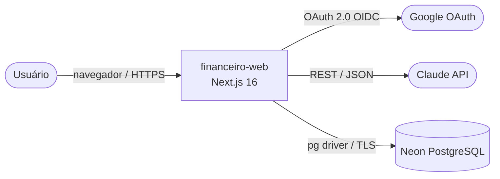

# Visão geral

O **financeiro-web** é uma aplicação web de controle financeiro pessoal voltada para uso privado com suporte a múltiplos usuários isolados. O sistema permite que cada usuário importe extratos bancários e faturas de cartão de crédito em formatos CSV, OFX e PDF, categorize os lançamentos de forma manual ou automática (via regras e inteligência artificial), e visualize painéis analíticos com totais, evolução mensal, matriz de gastos por categoria, previsão de despesas e controle de empréstimos. A documentação destina-se a desenvolvedores que trabalham na manutenção ou evolução do sistema.

## Objetivo do sistema

Centralizar o registro, categorização e análise de lançamentos financeiros provenientes de múltiplas contas bancárias e cartões de crédito de um ou mais usuários cadastrados, substituindo planilhas manuais por uma interface web com importação automatizada. O ponto de entrada principal é `src/app/layout.tsx`, que encapsula a sessão e decide se o usuário exibe a navegação completa ou é redirecionado ao onboarding.

## Escopo

### Dentro do escopo

- Importação de extratos nos formatos CSV, OFX e PDF — `src/lib/importacao/engine.ts:21`
- Categorização automática por Memória Local, histórico e regras de texto, mais sugestões da IA (Claude) revisadas pelo usuário — `src/lib/categorias.ts`, `src/app/api/categorizar/route.ts`
- Dashboard com totais de entradas, saídas e saldo por período — `src/app/api/dashboard/route.ts:173`
- Matriz de gastos por categoria e descrição normalizada — `src/app/api/matriz/route.ts:517`
- Previsão de despesas fixas e parcelamentos — `src/app/api/previsao/route.ts:825`
- Controle de empréstimos pessoais por pessoa — `src/app/api/emprestimos/route.ts:275`
- Memória de IA (regras de correção de categoria por descrição) — `src/app/api/memoria-ia/route.ts:591`
- Perfis de importação configuráveis por banco e formato — `src/app/api/perfis/route.ts:723`
- Onboarding de novos usuários com configuração inicial — `src/app/onboarding/page.tsx`
- Autenticação via Google OAuth com lista de e-mails permitidos — `src/auth.ts:6`
- Isolamento de dados por usuário (multi-tenant por discriminador) — `src/lib/session.ts`

### Fora do escopo

- Pagamento de boletos ou transferências bancárias (integração de débito)
- Conexão direta com APIs de Open Banking para importação automática
- Suporte a múltiplas moedas
- Relatórios fiscais ou declaração de imposto de renda
- Notificações por e-mail ou push
- Controle de orçamento (budget) com metas por categoria

## Atores principais

| Ator | Tipo | Papel | Modo de interação | Evidência |
|---|---|---|---|---|
| Usuário final | Humano | Importa extratos, categoriza e analisa lançamentos | Interface gráfica web (Next.js App Router) | `src/components/Nav.tsx:1` |
| Google OAuth | Sistema | Provedor de identidade | Protocolo OAuth 2.0 / OIDC via NextAuth | `src/auth.ts:14` |
| Claude API (Anthropic) | Sistema | Sugere categorias para o que as regras não resolveram | SDK `@anthropic-ai/sdk` | `src/lib/categorizacao-inteligente.ts` |
| Neon PostgreSQL | Sistema | Persistência relacional | Driver `pg` com adaptador Prisma | `src/lib/db.ts:1` |

## Proposta de valor

- **Usuário final**: elimina o trabalho manual de copiar e categorizar lançamentos de múltiplos extratos, oferecendo importação em lote com detecção automática de banco e categorização por IA.
- **Google OAuth**: delega autenticação segura sem gerenciar senhas, garantindo acesso somente a e-mails autorizados.
- **Claude API**: sugere categorias (gravadas só após revisão) para descrições que não correspondem à Memória, ao histórico nem às regras.

## Visão de alto nível

## Como navegar a documentação

1. [./02-arquitetura.md](./02-arquitetura.md) — Visão em camadas e decisões de design
2. [./03-stack-e-dependencias.md](./03-stack-e-dependencias.md) — Inventário completo de tecnologias e versões
3. [./04-estrutura-do-projeto.md](./04-estrutura-do-projeto.md) — Organização de diretórios e convenções
4. [./05-modelo-de-dominio.md](./05-modelo-de-dominio.md) — Entidades, relacionamentos e vocabulário ubíquo
5. [./06-fluxos-de-negocio.md](./06-fluxos-de-negocio.md) — Fluxos end-to-end principais
6. [./07-interface-externa.md](./07-interface-externa.md) — Catálogo completo de rotas de API
7. [./08-frontend.md](./08-frontend.md) — Páginas, componentes e estratégia de renderização
8. [./09-backend.md](./09-backend.md) — Lógica de servidor, parsers e categorização
9. [./10-configuracao-e-ambientes.md](./10-configuracao-e-ambientes.md) — Variáveis de ambiente e ambientes
10. [./11-infraestrutura-e-deployment.md](./11-infraestrutura-e-deployment.md) — Deploy e infraestrutura
11. [./auth.md](./auth.md) — Autenticação e autorização
12. [./banco-de-dados.md](./banco-de-dados.md) — Modelo de persistência e migrações
13. [./integracoes-externas.md](./integracoes-externas.md) — Google OAuth e Claude API
14. [./multi-tenancy.md](./multi-tenancy.md) — Isolamento de dados por usuário
15. [./13-glossario.md](./13-glossario.md) — Glossário com 60+ termos do domínio
