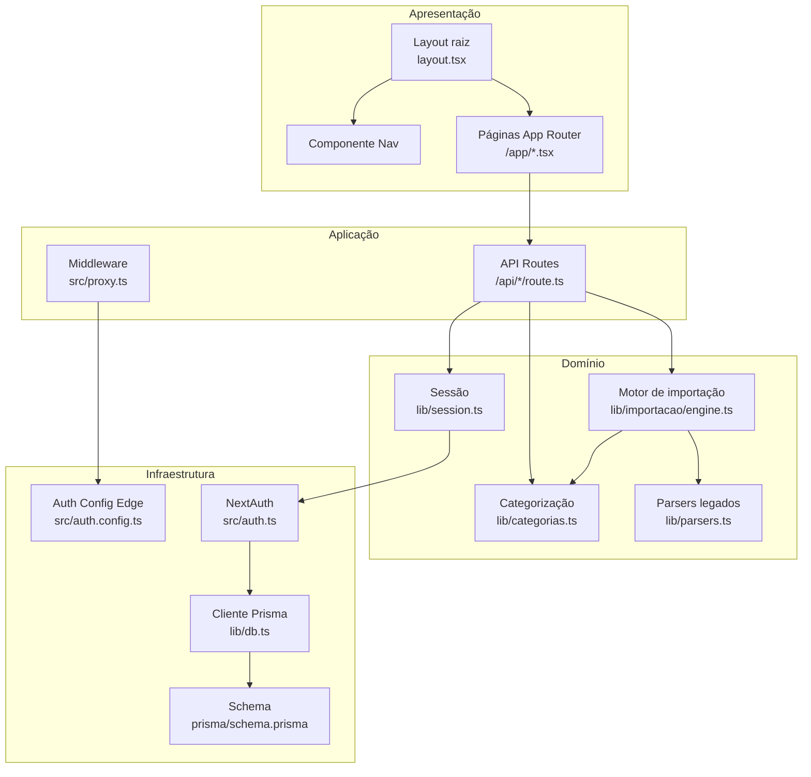

# Arquitetura

## Visão em camadas

| Camada | Responsabilidade | Fronteira (o que não faz) | Diretório-raiz |
|---|---|---|---|
| Apresentação | Renderiza páginas (Server e Client Components), roteamento Next.js App Router, componentes de interface e navegação | Não contém lógica de negócio nem acesso direto ao banco | `src/app/` |
| Aplicação | Handlers de API Route (`route.ts`), orquestração de casos de uso, autenticação via middleware | Não renderiza HTML nem acessa banco de dados diretamente sem a camada de domínio | `src/app/api/` |
| Domínio | Motor de importação, categorização, parsers de formatos bancários, definição de entidades e categorias | Não conhece framework web nem detalhes de persistência | `src/lib/` |
| Infraestrutura | Conexão Prisma com Neon PostgreSQL, adaptador de banco, schema, migrações, configuração de autenticação | Não contém lógica de negócio | `src/lib/db.ts`, `prisma/`, `src/auth.ts` |

## Diagrama de componentes internos

## Fluxo principal de uma requisição

Exemplo: usuário acessa `/lancamentos` após autenticado.

1. Navegador envia `GET /lancamentos` — o middleware `src/proxy.ts:10` intercepta a requisição antes de chegar ao servidor Next.js.
2. Middleware instancia NextAuth com `authConfig` (Edge-compatible) e valida o cookie JWT — `src/proxy.ts:8`.
3. Se `onboardingCompleto === false`, redireciona para `/onboarding`; caso contrário, passa adiante — `src/proxy.ts:23`.
4. Next.js App Router roteia para `src/app/lancamentos/page.tsx` (Server Component), que é renderizado no servidor.
5. O Client Component embutido na página chama `GET /api/lancamentos` via `fetch` com parâmetros de filtro — `src/app/api/lancamentos/route.ts:348`.
6. A API Route chama `getSessionUserId()` para extrair o `userId` da sessão — `src/lib/session.ts`.
7. Prisma executa `findMany({ where: { userId, ...filtros } })` no Neon PostgreSQL — `src/app/api/lancamentos/route.ts:380`.
8. O JSON retornado é hidratado no Client Component e exibido na tabela de lançamentos.

**Caminho de erro mais comum**: token JWT expirado ou ausente — o middleware redireciona para `/login` — `src/proxy.ts:11`.

## Decisões de design

| Decisão | Motivo | Consequência aceita | Evidência |
|---|---|---|---|
| Separar `auth.config.ts` de `auth.ts` | O middleware roda no Edge Runtime; Prisma (Node.js nativo) não pode ser importado nesse contexto | A configuração de provedores OAuth fica duplicada em dois arquivos | `src/auth.config.ts:1`, `src/proxy.ts:5` |
| `userId` = e-mail Google como discriminador de tenant | Simplicidade — o e-mail é único, estável e já disponível na sessão JWT | Dependência de e-mail Google como chave estrangeira lógica em todas as tabelas | `src/lib/session.ts:1`, `prisma/schema.prisma:1` |
| `onboardingCompleto` armazenado no JWT | O middleware Edge não pode consultar banco; precisa da informação no token | Se o estado muda no servidor, requer chamada `update()` do lado do cliente para refletir imediatamente | `src/auth.ts:32`, `src/proxy.ts:23` |
| Motor de importação com perfis configuráveis + legado | O sistema começou com parsers fixos para C6/Nubank; precisou evoluir para suporte a qualquer banco | Dois caminhos de execução coexistem em `engine.ts` (builtin e genérico) | `src/lib/importacao/engine.ts:29` |
| Categorias como lista estática tipada | Evita entidade de banco para categorias; simplifica categorização e relatórios | Adicionar nova categoria requer código, não apenas dado | `src/lib/categorias.ts:1` |
| `serverExternalPackages` para Prisma e pdf-parse | Esses pacotes usam módulos nativos Node.js; o bundler Next.js os excluiria do bundle | Ligeiramente maior cold start de funções serverless | `next.config.ts:1` |

## Limites da arquitetura

- **Escala single-user concentrado em função serverless**: toda a lógica de importação e categorização roda dentro de API Routes sem fila ou processamento em background; arquivos muito grandes podem exceder timeout de função serverless.
- **Sem camada de cache**: cada requisição ao dashboard consulta o banco diretamente; em volumes elevados de lançamentos, a latência aumenta linearmente — `src/app/api/dashboard/route.ts:190`.
- **Parsers legados acoplados**: os parsers C6/Nubank em `src/lib/parsers.ts` são caminhos de código separados do motor genérico; bugs precisam ser corrigidos em dois lugares — `src/lib/importacao/engine.ts:29`.
- **Lista de e-mails permitidos estática**: autorização de acesso é feita por variável de ambiente `ALLOWED_EMAILS`; não há interface de gerenciamento de usuários — `src/auth.ts:6`.
- **Sem testes automatizados**: // CARÊNCIA: não identificado no código.
