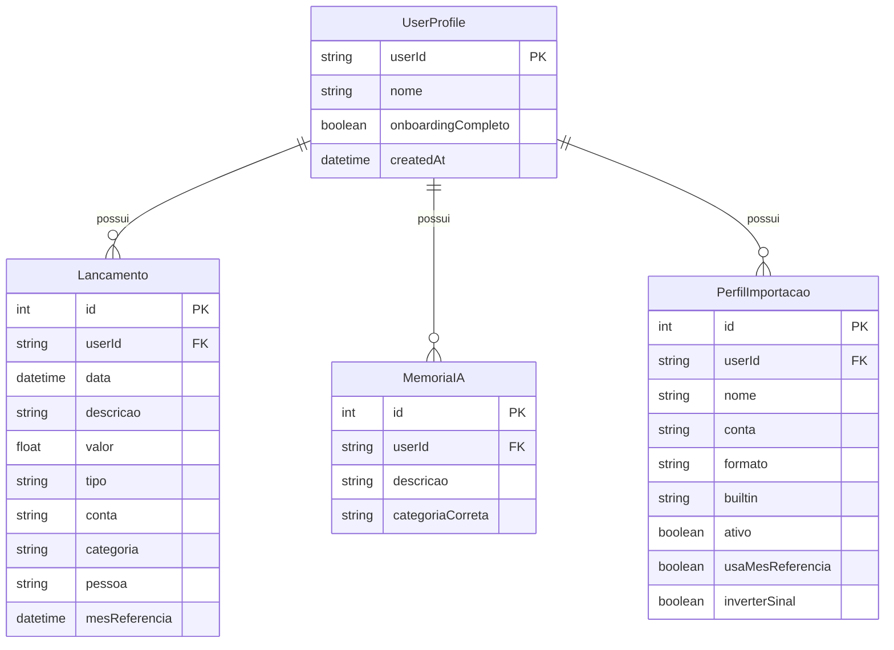

# Modelo de domínio

## Inventário de entidades

| Entidade | Responsabilidade no domínio | Evidência |
|---|---|---|
| `Lancamento` | Registro de uma transação financeira (débito ou crédito) em uma conta ou cartão de um usuário | `prisma/schema.prisma:Lancamento` |
| `UserProfile` | Perfil do usuário com nome, estado do onboarding, margem da fotografia (`margemPercentual`) e data de conclusão da fotografia (`fotografiaConcluidaEm`) | `prisma/schema.prisma:UserProfile` |
| `PlanejamentoItem` | Item da Fotografia do mês: o que o usuário planeja receber (entrada) ou gastar (fixo, variável, sazonal, parcela), com categoria do sistema, valor e periodicidade; parcelas guardam atual/total | `prisma/schema.prisma:PlanejamentoItem`, `src/lib/planejamento.ts:1` |
| `Conta` | Tipo de cada conta do usuário (`corrente` ou `cartao`), chaveada pelo mesmo nome gravado em `Lancamento.conta`; decide como os gastos entram nos painéis de meio de pagamento | `prisma/schema.prisma:Conta`, `src/lib/contas.ts` |
| `Reembolso` | Vínculo "Dividir" entre um Pix recebido (categoria Reembolso) e os gastos que ele devolve, com a parte atribuída a cada um; a soma fica em `Lancamento.valorReembolsado` e todas as somas de gasto usam o valor líquido | `prisma/schema.prisma:Reembolso`, `src/lib/reembolso.ts` |
| `MemoriaIA` | Regra de correção de categoria vinculada a uma descrição exata; base de conhecimento por usuário | `prisma/schema.prisma:MemoriaIA` |
| `PerfilImportacao` | Configuração de mapeamento de colunas e metadados para um banco/formato de importação específico | `prisma/schema.prisma:PerfilImportacao` |

## Relacionamentos e cardinalidades

## Invariantes de negócio

| Invariante | Entidade afetada | Ponto de imposição | Evidência |
|---|---|---|---|
| Um lançamento pertence sempre a exatamente um usuário (`userId` obrigatório) | `Lancamento` | Prisma schema (`userId String`) + `getSessionUserId()` em todas as API Routes | `prisma/schema.prisma`, `src/app/api/lancamentos/route.ts:349` |
| Operações de leitura e escrita nunca atravessam fronteiras de usuário (filtro `userId` obrigatório em todo `findMany`) | Todas | Convenção manual nas API Routes | `src/app/api/lancamentos/route.ts:363` |
| Uma `MemoriaIA` tem chave única composta `(descricao, userId)` — não há regras duplicadas por usuário | `MemoriaIA` | Restrição `@@unique([descricao, userId])` no schema Prisma + `upsert` na API | `prisma/schema.prisma:MemoriaIA`, `src/app/api/memoria-ia/route.ts:610` |
| Um `PerfilImportacao` marcado como `builtin` não pode ser excluído | `PerfilImportacao` | Filtro `builtin: null` no DELETE da API | `src/app/api/perfis/route.ts:790` |
| Um usuário só acessa o sistema principal após `onboardingCompleto = true` | `UserProfile` | Middleware verifica `session.onboardingCompleto === false` e redireciona | `src/proxy.ts:23` |
| `tipo` de um lançamento é restrito a `"Entrada"` ou `"Saída"` | `Lancamento` | // CARÊNCIA: não há constraint de banco; imposição é feita nos parsers de importação | `src/lib/importacao/tipos.ts:9` |

## Vocabulário ubíquo

| Termo | Definição neste sistema | Codificação | Evidência |
|---|---|---|---|
| Lançamento | Uma transação financeira (débito ou crédito) em uma conta ou cartão | Entidade `Lancamento` no Prisma schema | `prisma/schema.prisma:Lancamento` |
| Entrada | Lançamento que representa crédito (receita) na conta | `tipo = "Entrada"` em `Lancamento` | `src/lib/importacao/tipos.ts:9` |
| Saída | Lançamento que representa débito (despesa) na conta | `tipo = "Saída"` em `Lancamento` | `src/lib/importacao/tipos.ts:9` |
| Categoria | Classificação semântica de um lançamento (ex: "Supermercado e Mercearia") | Campo `categoria` em `Lancamento`; lista em `CATEGORIAS` | `src/lib/categorias.ts:1` |
| Conta | Identificador da conta ou cartão de origem do lançamento (ex: "Nubank Cartão") | Campo `conta` em `Lancamento` | `prisma/schema.prisma:Lancamento` |
| Meio de pagamento | Como um gasto saiu: cartão (conta do tipo cartão, pelo mês da fatura), Pix, débito, juros e encargos ou boletos e contas (demais saídas de conta corrente) | `Meio` / `classificarMeio` | `src/lib/financas.ts` |
| Custo de dívida | Juros, IOF e multas pagos por usar crédito, menos devoluções do banco; agrupado por origem (cheque especial, atraso de fatura, rotativo) | `custoDivida` / `origemEncargo` | `src/lib/financas.ts` |
| Guardado | Saídas para Investimentos (Aportes): mostradas à parte, fora do total de gastos | `CATEGORIA_INVESTIMENTO` | `src/lib/financas.ts` |
| Reembolso | Entrada que devolve parte de um gasto (conta dividida, racha); abate o gasto vinculado no mês dele e só a sobra (o que não abateu gasto) conta como renda | Categoria `Reembolso`, entidade `Reembolso`, `valorLiquido` | `src/lib/reembolso.ts` |
| Memória da IA | Conjunto de regras de correção de categoria baseadas em descrição exata, aprendidas por interação do usuário | Entidade `MemoriaIA` | `prisma/schema.prisma:MemoriaIA` |
| Perfil de importação | Configuração de como interpretar um arquivo de extrato de um banco específico (mapeamento de colunas, formato de data, etc.) | Entidade `PerfilImportacao` | `prisma/schema.prisma:PerfilImportacao` |
| Perfil nativo (builtin) | Perfil pré-configurado para um banco suportado pelo sistema, identificado por chave string em `builtin` | Campo `builtin` em `PerfilImportacao` | `src/app/api/perfis/route.ts:656` |
| Mês de referência (`mesReferencia`) | Data de competência de um lançamento, distinta da data da transação; usado em faturas de cartão | Campo `mesReferencia` em `Lancamento` | `prisma/schema.prisma:Lancamento` |
| Categoria neutra | Categoria que representa movimentação interna entre contas (ex: "Pagamento de Cartão de Crédito") e é excluída dos totais | Conjunto `CATEGORIAS_NEUTRAS` | `src/app/api/dashboard/route.ts:167` |
| Onboarding | Fluxo de configuração inicial que um novo usuário percorre ao primeiro login | Campo `onboardingCompleto` em `UserProfile`; rota `/onboarding` | `prisma/schema.prisma:UserProfile` |
| Motor de importação | Componente que converte arquivo (CSV/OFX/PDF) + perfil em lista de `LancamentoImportado` | `src/lib/importacao/engine.ts` | `src/lib/importacao/engine.ts:21` |
| Pessoa | Campo de texto livre em `Lancamento` para rastrear terceiros em empréstimos | Campo `pessoa` em `Lancamento` | `prisma/schema.prisma:Lancamento` |
| Empréstimo | Lançamento com categoria "Empréstimo" ou "Recebimento de Empréstimo"; agrupado por pessoa | Categorias em `CATEGORIAS_EMPRESTIMO` | `src/lib/categorias.ts:101` |
| Categorias fixas | Categorias de despesas que tendem a se repetir mensalmente; usadas para previsão | Array `CATEGORIAS_FIXAS` | `src/lib/categorias.ts:103` |

## Agregados e raízes

// CARÊNCIA: não identificado no código. O projeto não aplica o padrão de agregado DDD explicitamente; o `userId` funciona como chave de isolamento de tenant, mas não há raízes de agregado formalizadas.
