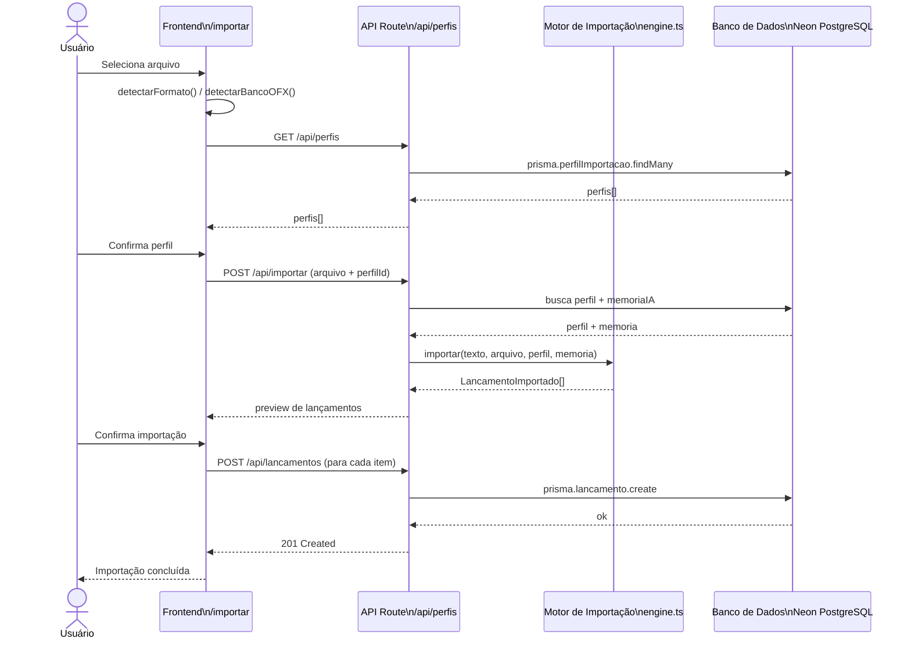
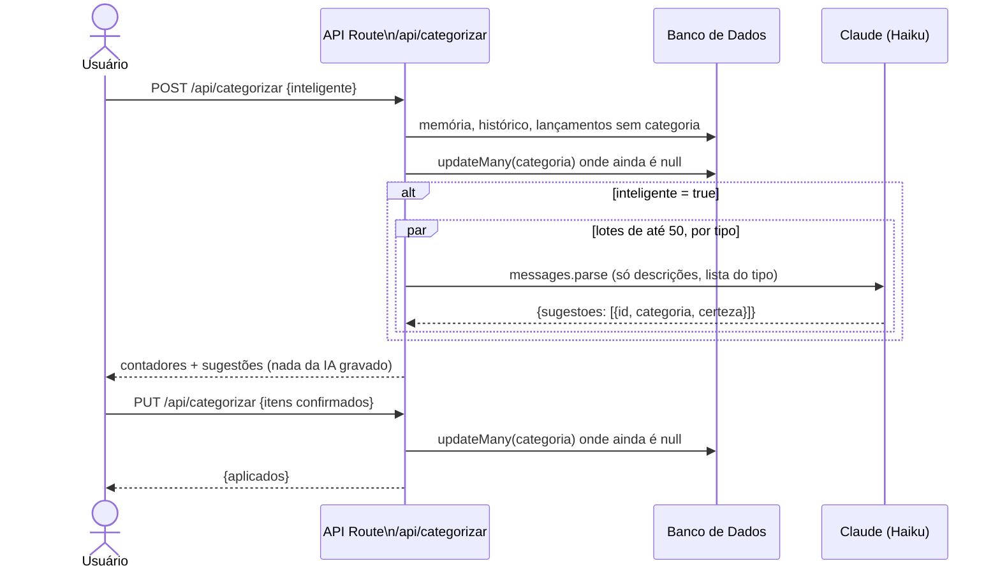

# Fluxos de negócio

## Inventário de fluxos

| Fluxo | Ator iniciador | Ponto de entrada | Evidência |
|---|---|---|---|
| Autenticação e onboarding | Usuário | `GET /login` → Google OAuth → `/onboarding` | `src/auth.ts:16`, `src/proxy.ts:23` |
| Fotografia do mês (pré-configuração) | Usuário | Passo 2 do onboarding ou `/planejamento` → `PUT /api/planejamento` | `src/components/planejamento/FotografiaWizard.tsx`, `src/app/api/planejamento/route.ts:71` |
| Planejado × Realizado | Usuário | `/planejamento?aba=comparacao` → `GET /api/planejamento/realizado` | `src/app/api/planejamento/realizado/route.ts:37` |
| Importação em lote | Usuário | `/importar` com vários arquivos → `POST /api/importar/analisar` por arquivo → `POST /api/importar` em sequência | `src/components/importacao/ImportacaoLote.tsx`, `src/app/importar/page.tsx` |
| Lançamento manual | Usuário | `/lancamentos` → **+ Novo** → `POST /api/lancamentos` | `src/components/LancamentoForm.tsx` |
| Importação de extrato | Usuário | `POST /api/importar` (rota interna de preview + confirmação) | `src/app/importar/page.tsx` |
| Categorização automática | Usuário | `POST /api/categorizar` | `src/app/api/categorizar/route.ts:7` |
| Visualização do dashboard | Usuário | `GET /api/dashboard` | `src/app/api/dashboard/route.ts:173` |
| Correção manual de categoria | Usuário | `PUT /api/lancamentos` (atualização em lote) | `src/app/api/lancamentos/route.ts:427` |
| Consulta de empréstimos | Usuário | `GET /api/emprestimos` | `src/app/api/emprestimos/route.ts:275` |
| Previsão de despesas | Usuário | `GET /api/previsao` | `src/app/api/previsao/route.ts:825` |

---

## Fluxo: Importação de extrato bancário

### Descrição

O usuário seleciona um arquivo (CSV, OFX ou PDF) de extrato bancário ou fatura de cartão, escolhe (ou confirma automaticamente) o perfil de importação adequado, visualiza um preview dos lançamentos detectados e confirma o salvamento no banco de dados.

### Pré-condições

- Usuário autenticado com `onboardingCompleto = true`
- Perfis de importação disponíveis (nativos são criados automaticamente no primeiro acesso) — `src/app/api/perfis/route.ts:700`
- Arquivo no formato suportado: CSV, OFX ou PDF

### Passos do caminho feliz

1. Usuário acessa `/importar` — `src/app/importar/page.tsx` renderiza o formulário de upload.
2. Usuário seleciona arquivo e o sistema lê o conteúdo no cliente via `FileReader`.
3. `detectarFormato()` determina o formato (CSV/OFX/PDF) a partir da extensão e do cabeçalho do arquivo — `src/lib/importacao/detectar.ts:38`.
4. Para OFX: `detectarBancoOFX()` extrai `FID`/`ORG` e mapeia para a `builtinKey` correspondente — `src/lib/importacao/detectar.ts:49`.
5. Para CSV reconhecido de fatura C6, `detectarPerfilCSV()` seleciona o perfil nativo, já com sinal invertido, mês de referência e coluna de parcela configurados; para os demais arquivos, o usuário confirma o perfil sugerido ou escolhe outro da lista.
6. O frontend envia `POST /api/importar` (ou equivalente de preview) com o conteúdo do arquivo e o `id` do perfil selecionado.
7. A API Route carrega o perfil de importação do banco via Prisma — `src/app/api/perfis/route.ts:723`.
8. A API carrega a `MemoriaIA` do usuário para usar no motor — `src/app/api/categorizar/route.ts:15`.
9. `importar()` é chamado com texto, nome do arquivo, perfil e memória — `src/lib/importacao/engine.ts:21`.
10. Para perfis `builtin` CSV: `parseFaturaC6` / `parseExtratoC6` / `parseFaturaNubank` / `parseExtratoNubank` — `src/lib/importacao/engine.ts:37`.
11. Para OFX genérico: `parseOFX()` — `src/lib/importacao/ofx.ts`.
12. Para PDF: `parsePDF()` — `src/lib/importacao/pdf.ts`.
13. Para CSV genérico: `parseCSVGenerico()` com mapeamento de colunas do perfil; quando `colParcela` está configurada, acrescenta `(N/M)` à descrição para alimentar a previsão — `src/lib/importacao/csv.ts`.
14. O motor retorna `LancamentoImportado[]` com data, descrição, valor, tipo, conta e mesReferência — `src/lib/importacao/tipos.ts:4`.
15. `mapearCategoria()` é aplicado a cada lançamento para tentar categorização automática — `src/lib/categorias.ts:115`.
16. O frontend exibe o preview da lista de lançamentos ao usuário.
17. Usuário confirma; o frontend envia `POST /api/lancamentos` para cada lançamento ou em lote — `src/app/api/lancamentos/route.ts:393`.
18. Cada lançamento é salvo com `prisma.lancamento.create({ data: { ...body, userId } })` — `src/app/api/lancamentos/route.ts:398`.

### Caminho de erro principal

1. Arquivo com formato não reconhecido ou corrompido — `detectarFormato()` retorna `"csv"` como fallback e `parseCSVGenerico()` lança erro ou retorna lista vazia — `src/lib/importacao/detectar.ts:46`.
2. A API retorna `400` ou lista vazia; o frontend exibe mensagem de erro ao usuário.

### Pós-condições

- **Caminho feliz**: os lançamentos confirmados são persistidos no banco com `userId` correto; categorias automáticas são atribuídas.
- **Caminho de erro**: nenhum lançamento é salvo; o estado do banco permanece inalterado.

### Diagrama de sequência

---

## Fluxo: Categorização automática

### Descrição

O usuário solicita a categorização de lançamentos sem categoria. O sistema aplica, em sequência e gravando direto: Memória Local (pela chave normalizada), regra de delivery, histórico do próprio usuário (categoria usada em ≥ 75% das vezes para o mesmo estabelecimento) e regras de texto. A mesma ordem vale na importação (`categorizarComOrigem`, `src/lib/categorias.ts`; carga em `src/lib/memoria.ts`). No botão "✨ Inteligente" (categorização inteligente), o que sobrar recebe **sugestões** do Claude, que o usuário revisa antes de gravar.

### Pré-condições

- Existência de lançamentos com `categoria = null` para o usuário
- Para a categorização inteligente: `ANTHROPIC_API_KEY` no servidor (sem ela o botão não aparece)

### Passos do caminho feliz

1. Usuário aciona "🧠 Categorizar" ou "✨ Inteligente" — a interface chama `POST /api/categorizar` (`{ inteligente }`).
2. A API carrega Memória Local, histórico e apelidos do usuário (`carregarMemoriaCategorizacao`).
3. Para cada lançamento sem categoria: Memória → delivery → histórico → regras (`categorizarComOrigem`).
4. Os resolvidos são gravados numa transação, só onde o lançamento continua sem categoria.
5. **Categorização inteligente** (só com `inteligente: true`): até 200 lançamentos restantes vão ao Claude Haiku (`src/lib/categorizacao-inteligente.ts`) — só a descrição, entradas e saídas em pedidos separados, lotes de 50 em paralelo, resposta presa à lista de categorias do tipo.
6. A API devolve contadores e as **sugestões** `{ id, categoria, certeza, descricao, data, valor, conta }` — nada da IA é gravado.
7. A tela abre a revisão (`RevisaoInteligente`): certeza alta já marcada, categoria editável; "Aplicar" chama `PUT /api/categorizar` com os itens confirmados, gravados só onde ainda não há categoria.

### Caminho de erro principal

1. Sem `ANTHROPIC_API_KEY`: `inteligente: "sem-chave"` (e o botão nem aparece).
2. Erro do serviço (HTTP, rede, recusa, resposta incompleta): `inteligente: "erro"` com `inteligenteErro`; a tela avisa e o que outros lotes sugeriram continua valendo.
3. Lançamentos sem correspondência e sem sugestão segura permanecem com `categoria = null`.

### Pós-condições

- **Caminho feliz**: o que as regras resolvem fica gravado; o que a IA sugeriu só é gravado depois da confirmação.
- **Caminho de erro da IA**: fases locais executadas normalmente; nenhuma sugestão aplicada sem revisão.

### Diagrama de sequência

## Métricas de saúde do fluxo

// CARÊNCIA: não identificado no código. O sistema não possui instrumentação com métricas, logs estruturados ou identificadores de correlação.
