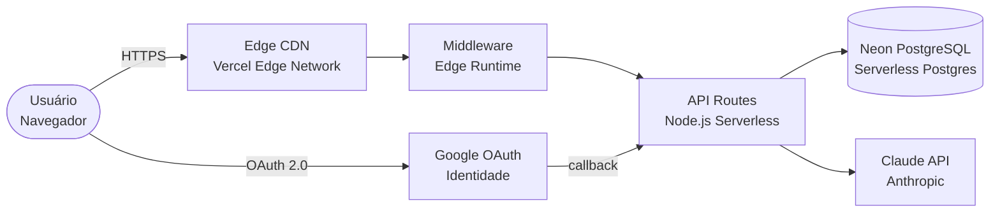

# Infraestrutura e deployment

## Topologia de produção



## Plataforma de deploy

O projeto é projetado para deploy na **Vercel** (plataforma serverless para Next.js). Evidência: `SETUP.md` documenta o processo de deploy via Vercel, e a separação entre `auth.config.ts` (Edge-compatible) e `auth.ts` (Node.js) foi implementada especificamente para compatibilidade com o Edge Runtime do Vercel Middleware.

## Componentes de infraestrutura

| Componente | Produto / Tecnologia | Função | Evidência |
|---|---|---|---|
| Plataforma de hosting | Vercel (serverless) | Serve Next.js: SSR, API Routes, assets estáticos, Edge Middleware | `SETUP.md` |
| Banco de dados | Neon PostgreSQL | Persistência relacional serverless com connection pooling | `src/lib/db.ts:1` |
| Provedor de identidade | Google OAuth 2.0 / OIDC | Autenticação de usuários | `src/auth.ts:14` |
| Modelo de linguagem | Claude Haiku 5.5 (Anthropic) | Sugestões de categoria revisadas pelo usuário | `src/lib/categorizacao-inteligente.ts` |

## Runtimes

| Componente | Runtime | Motivo |
|---|---|---|
| `src/proxy.ts` | Node.js (padrão do Proxy no Next 16) | Continua importando só `auth.config.ts` (sem Prisma) por segurança, caso volte a rodar no Edge | `src/proxy.ts:1` |
| API Routes (`/api/**`) | Node.js (serverless function) | Requer Prisma (`@prisma/client` com módulos nativos) e pdf-parse | `next.config.ts:serverExternalPackages` |
| Páginas SSR | Node.js (serverless function) | Renderização de Server Components | `src/app/layout.tsx` |
| Assets estáticos | CDN Edge | Arquivos em `public/` e chunks JS/CSS gerados pelo build | — |

## Processo de build e deploy

1. `npm run build` executa `next build`, gerando os bundles estáticos, chunks de Server Components e manifests de API Routes.
2. O Vercel detecta automaticamente o projeto Next.js e aplica as configurações de `next.config.ts`.
3. Variáveis de ambiente são configuradas no painel Vercel (não em arquivo commitado).
4. `prisma generate` deve ser executado antes do build para gerar o cliente Prisma — `SETUP.md`.

## Migrações de banco

Processo documentado em `SETUP.md`:

```bash
npx prisma migrate dev --name <descricao>   # desenvolvimento
npx prisma migrate deploy                    # produção (aplica migrations pendentes)
```

Migrations são versionadas em `prisma/migrations/` com timestamp e descrição. A aplicação não executa migrações automaticamente no boot.

## Não identificado

- **CI/CD automatizado**: // CARÊNCIA: não há arquivos de pipeline (GitHub Actions, Vercel CI) no repositório.
- **Health check endpoint**: // CARÊNCIA: não identificado no código.
- **Monitoramento e alertas**: // CARÊNCIA: não identificado no código.
- **Backup de banco**: // CARÊNCIA: não identificado no código (Neon pode ter backup gerenciado na plataforma).
- **Rollback de deploy**: procedure não documentada no repositório.
