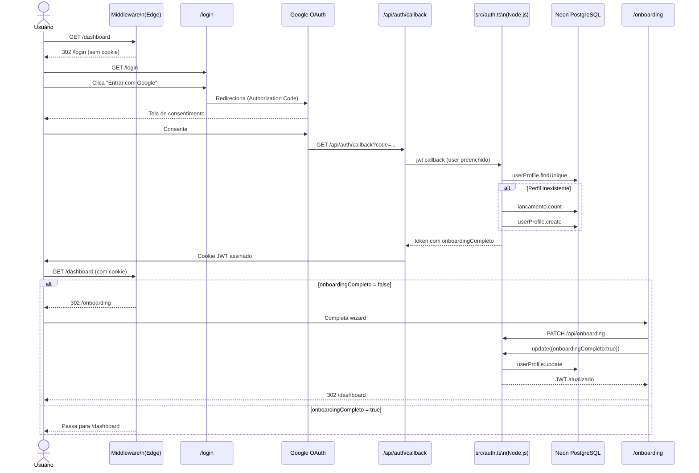

# Autenticação e autorização

## Modelo de identidade

| Atributo | Tipo | Origem | Evidência |
|---|---|---|---|
| `userId` | `string` (e-mail Google) | Google OAuth 2.0 / OIDC via NextAuth | `src/auth.ts:23` |
| `name` | `string` | Perfil Google (campo `name`) | NextAuth session padrão |
| `email` | `string` | Perfil Google; usado como chave de tenant em todas as tabelas | `src/lib/session.ts:1` |
| `image` | `string` (URL) | Avatar Google | NextAuth session padrão |
| `onboardingCompleto` | `boolean` | Tabela `UserProfile` do banco; propagado para JWT | `src/auth.ts:32`, `src/types/next-auth.d.ts:8` |

## Fluxos de autenticação suportados

| Fluxo | Iniciador | Provedor de identidade | Tipo de credencial emitida | Evidência |
|---|---|---|---|---|
| OAuth 2.0 Authorization Code com OIDC | Usuário via navegador | Google | Cookie de sessão JWT (`next-auth.session-token`) | `src/auth.ts:14` |

Não há autenticação por credenciais locais (e-mail/senha), tokens de API ou autenticação federada adicional.

## Fluxo de autenticação principal — passo a passo

1. Usuário acessa qualquer rota protegida — `src/proxy.ts:10`.
2. Middleware verifica o cookie JWT com `NextAuth(authConfig)` (Edge-compatible, sem Prisma) — `src/proxy.ts:8`.
3. Sessão ausente → middleware redireciona para `/login` — `src/proxy.ts:11`. Cada rota de API revalida a sessão por conta própria (`getSessionUserId`), então o proxy é a primeira camada, não a única.
4. Usuário clica em "Entrar com Google" na página `/login` — `src/app/login/page.tsx`.
5. NextAuth redireciona para o endpoint de autorização do Google com `scope=openid email profile`.
6. Usuário autentica no Google e consente.
7. Google redireciona para `/api/auth/callback/google` com `code`.
8. NextAuth troca o `code` por `id_token` + `access_token` junto ao Google.
9. NextAuth extrai `email` do `id_token` e chama o callback `signIn()` — `src/auth.ts:17`.
10. `signIn()` verifica se o e-mail está na `ALLOWED_EMAILS`; retorna `false` se não estiver → NextAuth redireciona para `/login?error=AccessDenied` — `src/auth.ts:17`.
11. E-mail autorizado → NextAuth chama o callback `jwt()` com `user` preenchido — `src/auth.ts:20`.
12. `jwt()` busca ou cria o `UserProfile` no banco via Prisma — `src/auth.ts:24`.
13. Se `UserProfile` não existir: verifica se o usuário já tem `Lancamento` (auto-graduação) → cria `UserProfile` com `onboardingCompleto: true` (se tiver dados) ou `false` — `src/auth.ts:26`.
14. `token.onboardingCompleto` é definido com o valor do perfil — `src/auth.ts:32`.
15. Callback `session()` adiciona `onboardingCompleto` ao objeto de sessão — `src/auth.ts:40`.
16. NextAuth cria o cookie JWT assinado com `AUTH_SECRET` e redireciona para a rota original.
17. Middleware lê o JWT no cookie e verifica `onboardingCompleto === false` — `src/proxy.ts:23`. Antes disso, o callback `jwt` revalida o e-mail contra `ALLOWED_EMAILS` a cada requisição e devolve `null` (sessão encerrada) se ele foi removido — `src/auth.ts:34`. A sessão dura 7 dias (`session.maxAge`) — `src/auth.ts:21`.
18. Se `false`: redireciona para `/onboarding`; se `true` ou `undefined` (sessões antigas): deixa passar — `src/proxy.ts:23`.
19. Usuário conclui onboarding → frontend chama `PATCH /api/onboarding` + `update({ onboardingCompleto: true })` — `src/app/onboarding/page.tsx`.
20. NextAuth atualiza o JWT com o novo valor via o trigger `"update"` no callback `jwt()` — `src/auth.ts:35`.

## Diagrama de sequência do fluxo principal

## Política de autorização

| Papel ou atributo | Capacidades concedidas | Ponto de imposição | Evidência |
|---|---|---|---|
| E-mail na `ALLOWED_EMAILS` | Acesso completo ao sistema; todos os dados são isolados por `userId` | Callback `signIn()` em `src/auth.ts:17` | `src/auth.ts:6` |
| `onboardingCompleto = true` | Acesso às rotas principais (dashboard, lançamentos, etc.) | Middleware — `src/proxy.ts:23` | `src/proxy.ts:23` |
| `onboardingCompleto = false` | Acesso restrito a `/onboarding` e `/api/*` | Middleware — `src/proxy.ts:18` | `src/proxy.ts:18` |
| E-mail fora da `ALLOWED_EMAILS` | Sem acesso; redirecionado para `/login?error=AccessDenied` | Callback `signIn()` retorna `false` | `src/auth.ts:18` |

Não há papéis (roles) diferenciados entre usuários autorizados; todos têm as mesmas capacidades dentro do seu tenant.

## Gestão de sessões e renovação de credenciais

| Item | Valor | Evidência |
|---|---|---|
| Duração da credencial de acesso (JWT) | Padrão NextAuth v5 (30 dias) | // CARÊNCIA: duração não customizada no código |
| Duração da credencial de renovação | NextAuth v5 usa sessão stateless por JWT; não há refresh token separado | `src/auth.ts:13` |
| Estratégia de renovação | JWT rotacionado automaticamente pelo NextAuth a cada requisição | NextAuth v5 padrão |
| Mecanismo de revogação | // CARÊNCIA: não há lista de revogação; logout invalida apenas o cookie local | `src/auth.ts` |
| Atualização manual do JWT | `update()` do `next-auth/react` no cliente após mudança de `onboardingCompleto` | `src/app/onboarding/page.tsx` |

## Armazenamento de credenciais sensíveis

- `AUTH_SECRET`: variável de ambiente; nunca commitada no repositório.
- `AUTH_GOOGLE_ID` / `AUTH_GOOGLE_SECRET`: variáveis de ambiente.
- `GEMINI_API_KEY`: variável de ambiente.
- `DATABASE_URL`: variável de ambiente com credenciais de banco; transmitida via conexão TLS para o Neon.
- Nenhum segredo é logado ou exposto em respostas de API.

## Trilhas de auditoria

| Evento | Estrutura do registro | Destino | Evidência |
|---|---|---|---|
| Login bem-sucedido | // CARÊNCIA: não identificado no código | — | — |
| Login negado (e-mail não autorizado) | // CARÊNCIA: não identificado no código | — | — |
| Onboarding concluído | // CARÊNCIA: não identificado no código | — | — |

O sistema não possui trilha de auditoria de eventos de autenticação além dos logs padrão da plataforma de hosting.
