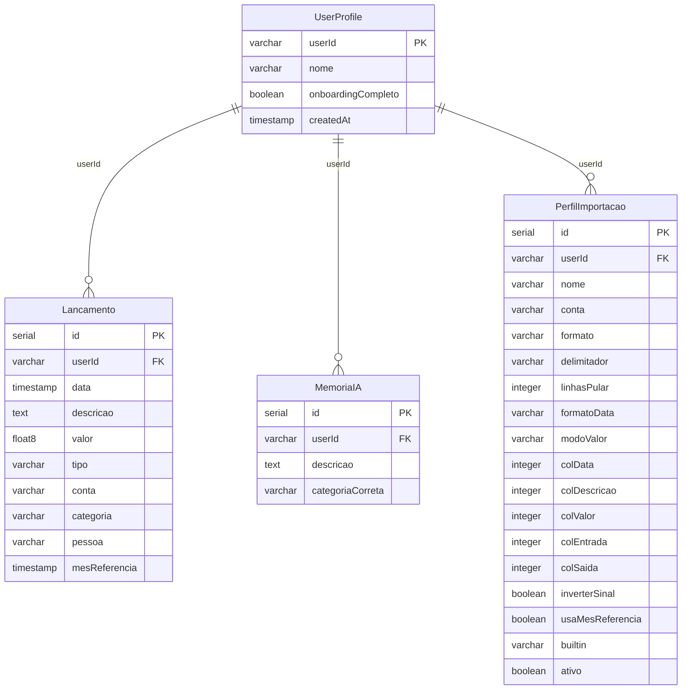

# Banco de dados

## Mecanismo de persistência

| Mecanismo | Versão | Biblioteca de acesso | Versão da biblioteca | Evidência |
|---|---|---|---|---|
| PostgreSQL (Neon Serverless) | // CARÊNCIA: versão do Postgres não declarada no projeto | Prisma ORM | 7.8.0 (`^7.8.0`) | `src/lib/db.ts:1`, `package.json` |

## Conexões nomeadas

| Alias | Host | Banco | Modo | Pool máximo | Evidência |
|---|---|---|---|---|---|
| default | `DATABASE_URL` (Neon endpoint) | `financeiro` (configurado na Neon) | Leitura e escrita | // CARÊNCIA: pool size não configurado explicitamente | `src/lib/db.ts:2` |

O `pg.Pool` é instanciado com `connectionString: process.env.DATABASE_URL` sem configuração explícita de `max` ou `idleTimeoutMillis` — `src/lib/db.ts`.

## Modelo físico



## Inventário de entidades persistidas

| Entidade | Tabela ou coleção | Chave primária | Evidência |
|---|---|---|---|
| `Lancamento` | `Lancamento` | `id` (auto-incremento) | `prisma/schema.prisma:Lancamento` |
| `UserProfile` | `UserProfile` | `userId` (e-mail Google) | `prisma/schema.prisma:UserProfile` |
| `MemoriaIA` | `MemoriaIA` | `id` (auto-incremento) | `prisma/schema.prisma:MemoriaIA` |
| `PerfilImportacao` | `PerfilImportacao` | `id` (auto-incremento) | `prisma/schema.prisma:PerfilImportacao` |

### Campos notáveis

**`Lancamento`**:
- `mesReferencia`: data de competência do lançamento (nullable); quando presente, é usado no lugar de `data` para cálculos de período — `src/app/api/dashboard/route.ts:193`.
- `categoria`: nullable; ausência indica que o lançamento ainda não foi categorizado.
- `pessoa`: texto livre para rastrear terceiros em operações de empréstimo.

**`PerfilImportacao`**:
- `builtin`: chave string identificando perfis nativos pré-configurados (ex: `"nubank-corrente-ofx"`); `null` para perfis personalizados.
- `ativo`: controla se o perfil aparece na lista de importação (soft delete funcional).
- `usaMesReferencia`: quando `true`, os lançamentos importados recebem `mesReferencia` (padrão em faturas de cartão).

**`MemoriaIA`**:
- Restrição `@@unique([descricao, userId])`: garante uma única regra por descrição exata por usuário — `prisma/schema.prisma:MemoriaIA`.

## Padrão de migrações

| Item | Descrição | Evidência |
|---|---|---|
| Ferramenta de migração | Prisma Migrate (`prisma migrate dev` / `prisma migrate deploy`) | `prisma.config.ts`, `SETUP.md` |
| Diretório de migrações | `prisma/migrations/` | `prisma.config.ts` |
| Convenção de nomenclatura | `{timestamp}_{descricao}/migration.sql` (gerado automaticamente pelo Prisma) | `prisma/migrations/` |
| Política de aplicação | Manual — executar `prisma migrate deploy` antes de iniciar novo deploy | `SETUP.md` |

## Política de transações

As atualizações em lote da Memória IA e das regras manuais usam `prisma.$transaction()`, garantindo rollback dentro de cada fase local de categorização. A fase Gemini permanece individual: ela depende de chamadas externas e de espera por rate limit, portanto não deve manter uma transação aberta — `src/app/api/categorizar/route.ts`.

## Padrões de acesso a dados

O único ponto de acesso ao banco é o cliente Prisma singleton em `src/lib/db.ts`, instanciado com `PrismaPg` adapter:

```typescript
const pool = new Pool({ connectionString: process.env.DATABASE_URL });
const adapter = new PrismaPg(pool);
export const prisma = new PrismaClient({ adapter });
```

Todas as queries incluem `userId` no `where` para garantir isolamento de tenant. Não há acesso direto via SQL nativo (`prisma.$queryRaw`). Evidência: `src/lib/db.ts:1`.

## Otimizações estruturais

| Otimização | Objeto | Motivo | Evidência |
|---|---|---|---|
| Índice único composto | `MemoriaIA(descricao, userId)` | Previne regras duplicadas e acelera busca de memória | `prisma/schema.prisma:MemoriaIA @@unique` |
| Chave primária simples em `UserProfile` | `userId` (e-mail) como PK | Evita join com tabela separada de usuários; e-mail Google é estável | `prisma/schema.prisma:UserProfile` |
| Índices compostos por tenant | `Lancamento(userId, data)`, `Lancamento(userId, mesReferencia)`, `Lancamento(userId, categoria)`, `Lancamento(userId, pessoa)` | Aceleram filtros de período, categoria e empréstimos, todos delimitados pelo usuário autenticado | `prisma/schema.prisma:Lancamento`, `prisma/migrations/20260723120000_lancamento_tenant_indexes/migration.sql` |

// CARÊNCIA: ainda não há medição de plano de execução ou volume real para calibrar estes índices no Neon PostgreSQL.
