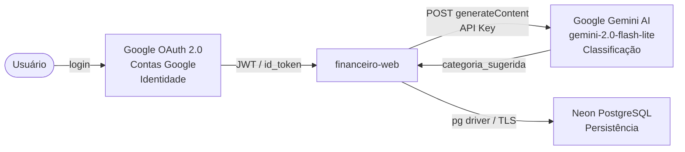

# Integrações externas

## Catálogo de integrações

| Integração | Propósito | Criticidade | Ambiente onde existe | Evidência |
|---|---|---|---|---|
| Google OAuth 2.0 / OIDC | Autenticação de usuários; emissão de identidade | Alta — sem ela nenhum usuário consegue acessar o sistema | Produção e desenvolvimento | `src/auth.ts:14` |
| Google Gemini AI (gemini-2.0-flash-lite) | Classificação de categorias de transações financeiras por IA generativa | Baixa — a funcionalidade degrada graciosamente sem a chave de API | Produção (opcional em desenvolvimento) | `src/app/api/categorizar/route.ts:124` |

## Contratos consumidos

| Integração | Contrato | Transporte | Formato | Autenticação | Evidência |
|---|---|---|---|---|---|
| Google OAuth | Authorization Code Flow: `GET https://accounts.google.com/o/oauth2/auth` → `POST https://oauth2.googleapis.com/token` | HTTPS/redirect | OAuth 2.0 parameters | Client ID + Client Secret (`AUTH_GOOGLE_ID`, `AUTH_GOOGLE_SECRET`) | `src/auth.ts:14` |
| Google OAuth | UserInfo: `GET https://openidconnect.googleapis.com/v1/userinfo` | HTTPS/JSON | JSON com `email`, `name`, `picture` | Bearer token (access_token) | NextAuth Google Provider |
| Gemini AI | `POST https://generativelanguage.googleapis.com/v1beta/models/gemini-2.0-flash-lite:generateContent?key={API_KEY}` | HTTPS/JSON | JSON com `contents`, `systemInstruction`, `generationConfig` | API Key via query param | `src/app/api/categorizar/route.ts:124` |

### Payload enviado ao Gemini

```json
{
  "contents": [{ "role": "user", "parts": [{ "text": "Descrição da transação: \"<descricao>\"" }] }],
  "systemInstruction": {
    "parts": [{ "text": "Analise a descrição de transação bancária e retorne UMA categoria da lista. Responda APENAS com o JSON.\n\nCategorias válidas: [...]" }]
  },
  "generationConfig": {
    "responseMimeType": "application/json",
    "responseSchema": { "type": "OBJECT", "properties": { "categoria_sugerida": { "type": "STRING" } } },
    "temperature": 0.0
  }
}
```

Evidência: `src/app/api/categorizar/route.ts:127`.

### Resposta esperada do Gemini

```json
{ "categoria_sugerida": "Supermercado e Mercearia" }
```

A resposta é validada contra a lista `CATEGORIAS` antes de ser aplicada — `src/app/api/categorizar/route.ts:90`.

## Tratamento de timeout, retentativa e disjuntor

| Integração | Timeout | Política de retentativa | Disjuntor | Evidência |
|---|---|---|---|---|
| Google OAuth | Gerenciado pelo NextAuth v5 internamente | // CARÊNCIA: não configurado no projeto | // CARÊNCIA: não identificado | `src/auth.ts:14` |
| Gemini AI | Padrão da plataforma (`fetch` sem timeout explícito) | Sem retentativa — erros são capturados e ignorados silenciosamente | // CARÊNCIA: não identificado | `src/app/api/categorizar/route.ts:99` |

**Rate limiting Gemini**: delay de 1100ms entre chamadas sequenciais para respeitar o limite da API — `src/app/api/categorizar/route.ts:98`.

## Plano de contingência por integração

| Integração | Cenário de falha | Plano de contingência | Responsável | Evidência |
|---|---|---|---|---|
| Google OAuth indisponível | Usuários não conseguem fazer login | // CARÊNCIA: sem fallback; o sistema fica inacessível | — | — |
| Gemini AI indisponível ou sem chave | Fase 3 de categorização não executa | Degrada graciosamente: fases 1 (memória) e 2 (regras) continuam funcionando; lançamentos sem categoria permanecem `null` | — | `src/app/api/categorizar/route.ts:83` |

## Mapa visual das integrações



## Versionamento de contratos externos

- **Google OAuth**: o NextAuth v5 Google Provider abstrai versionamento; atualizar `next-auth` reflete alterações de contrato.
- **Gemini AI**: o modelo `gemini-2.0-flash-lite` é fixado por nome no URL. Mudanças de API do Google Gemini requerem atualização manual da URL e do schema de resposta — `src/app/api/categorizar/route.ts:124`.
- Não há pinning de versão de API via cabeçalho ou parâmetro além do nome do modelo.
