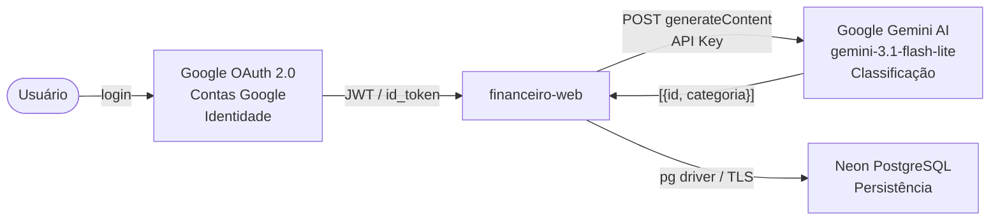

# Integrações externas

## Catálogo de integrações

| Integração | Propósito | Criticidade | Ambiente onde existe | Evidência |
|---|---|---|---|---|
| Google OAuth 2.0 / OIDC | Autenticação de usuários; emissão de identidade | Alta — sem ela nenhum usuário consegue acessar o sistema | Produção e desenvolvimento | `src/auth.ts:14` |
| Google Gemini AI (`gemini-3.1-flash-lite`, trocável por `GEMINI_MODEL`) | Classificação de categorias de transações financeiras por IA generativa, só no botão "✨ Inteligente" (categorização inteligente) | Baixa — sem a chave o botão não aparece | Produção (opcional em desenvolvimento) | `src/lib/gemini.ts` |

## Contratos consumidos

| Integração | Contrato | Transporte | Formato | Autenticação | Evidência |
|---|---|---|---|---|---|
| Google OAuth | Authorization Code Flow: `GET https://accounts.google.com/o/oauth2/auth` → `POST https://oauth2.googleapis.com/token` | HTTPS/redirect | OAuth 2.0 parameters | Client ID + Client Secret (`AUTH_GOOGLE_ID`, `AUTH_GOOGLE_SECRET`) | `src/auth.ts:14` |
| Google OAuth | UserInfo: `GET https://openidconnect.googleapis.com/v1/userinfo` | HTTPS/JSON | JSON com `email`, `name`, `picture` | Bearer token (access_token) | NextAuth Google Provider |
| Gemini AI | `POST https://generativelanguage.googleapis.com/v1beta/models/{GEMINI_MODEL}:generateContent` | HTTPS/JSON | JSON com `contents`, `systemInstruction`, `generationConfig` | API Key no header `x-goog-api-key` | `src/lib/gemini.ts` |

### Payload enviado ao Gemini

Um pedido por lote de até 50 lançamentos (até 200 por clique), com a lista em JSON:

```json
{
  "contents": [{ "role": "user", "parts": [{ "text": "[{\"id\":12,\"descricao\":\"LOJA X\",\"tipo\":\"Saída\"}, …]" }] }],
  "systemInstruction": { "parts": [{ "text": "…escolha UMA categoria da lista permitida… se não der para saber, deixe de fora" }] },
  "generationConfig": {
    "responseMimeType": "application/json",
    "responseSchema": { "type": "ARRAY", "items": { "type": "OBJECT", "properties": { "id": { "type": "INTEGER" }, "categoria": { "type": "STRING", "enum": ["…CATEGORIAS"] } } } },
    "temperature": 0
  }
}
```

### Resposta esperada do Gemini

```json
[{ "id": 12, "categoria": "Compras" }]
```

Só valem ids do próprio lote e categorias de `CATEGORIAS`; a gravação usa o escopo do usuário — `src/lib/gemini.ts`, `src/app/api/categorizar/route.ts`.

## Tratamento de timeout, retentativa e disjuntor

| Integração | Timeout | Política de retentativa | Disjuntor | Evidência |
|---|---|---|---|---|
| Google OAuth | Gerenciado pelo NextAuth v5 internamente | // CARÊNCIA: não configurado no projeto | // CARÊNCIA: não identificado | `src/auth.ts:14` |
| Gemini AI | 25 s por pedido (`AbortSignal.timeout`) | Sem retentativa: o erro interrompe os lotes seguintes, guarda o que já voltou e é mostrado na tela ("Gemini indisponível (HTTP 404)") | — | `src/lib/gemini.ts` |

## Plano de contingência por integração

| Integração | Cenário de falha | Plano de contingência | Responsável | Evidência |
|---|---|---|---|---|
| Google OAuth indisponível | Usuários não conseguem fazer login | // CARÊNCIA: sem fallback; o sistema fica inacessível | — | — |
| Gemini AI indisponível ou sem chave | Fase 3 de categorização não executa | Sem chave o botão "✨ Inteligente" (categorização inteligente) some; com erro, a tela avisa e as fases 1 (memória/histórico) e 2 (regras) continuam valendo; o restante fica sem categoria | — | `src/app/api/categorizar/route.ts` |

## Mapa visual das integrações



## Versionamento de contratos externos

- **Google OAuth**: o NextAuth v5 Google Provider abstrai versionamento; atualizar `next-auth` reflete alterações de contrato.
- **Gemini AI**: o modelo vai no URL; padrão `gemini-3.1-flash-lite` (`MODELO_PADRAO` em `src/lib/gemini.ts`), trocável pela variável `GEMINI_MODEL` sem deploy de código. O `gemini-2.0-flash-lite` usado antes foi desligado pelo Google em 01/06/2026.
- Não há pinning de versão de API via cabeçalho ou parâmetro além do nome do modelo.
