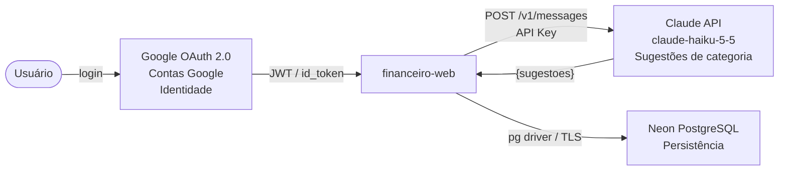

# Integrações externas

## Catálogo de integrações

| Integração | Propósito | Criticidade | Ambiente onde existe | Evidência |
|---|---|---|---|---|
| Google OAuth 2.0 / OIDC | Autenticação de usuários; emissão de identidade | Alta — sem ela nenhum usuário consegue acessar o sistema | Produção e desenvolvimento | `src/auth.ts:14` |
| Claude API (Anthropic), modelo `claude-haiku-5-5` (trocável por `IA_MODELO`) | Sugestões de categoria no botão "✨ Inteligente" (categorização inteligente), gravadas só após revisão do usuário | Baixa — sem a chave o botão não aparece | Produção (opcional em desenvolvimento) | `src/lib/categorizacao-inteligente.ts` |

## Contratos consumidos

| Integração | Contrato | Transporte | Formato | Autenticação | Evidência |
|---|---|---|---|---|---|
| Google OAuth | Authorization Code Flow: `GET https://accounts.google.com/o/oauth2/auth` → `POST https://oauth2.googleapis.com/token` | HTTPS/redirect | OAuth 2.0 parameters | Client ID + Client Secret (`AUTH_GOOGLE_ID`, `AUTH_GOOGLE_SECRET`) | `src/auth.ts:14` |
| Google OAuth | UserInfo: `GET https://openidconnect.googleapis.com/v1/userinfo` | HTTPS/JSON | JSON com `email`, `name`, `picture` | Bearer token (access_token) | NextAuth Google Provider |
| Claude API | `POST https://api.anthropic.com/v1/messages` via SDK oficial `@anthropic-ai/sdk` (`messages.parse`) | HTTPS/JSON | `system` (instrução + categorias), `messages` (lista de descrições), `output_config` (`effort: "low"`, JSON Schema) | `ANTHROPIC_API_KEY` | `src/lib/categorizacao-inteligente.ts` |

### Pedido enviado ao Claude

Um pedido por tipo (Entrada/Saída) e lote de até 50 lançamentos (até 200 por clique), em paralelo. Sai do app só `{ id, descricao }` — sem valor, data, conta ou nome do usuário.

- `system`: regras (na dúvida, deixar de fora; Pix/transferência para pessoa fica de fora; não adivinhar pelo nome; texto das descrições é só dado) + a lista de categorias do tipo, cada uma com o que cobre.
- `output_config.format`: JSON Schema `{ sugestoes: [{ id, categoria (enum da lista do tipo), certeza (alta|media|baixa) }] }`, enviado **sem** a transformação do SDK (ela rebaixa `enum` a texto de descrição).
- Fora da lista: categorias que dependem do contexto do usuário (transferências, pagamento de cartão, gastos de terceiros, PJ, empréstimos, reembolso, compra e venda de bens, aportes) e as genéricas (Outras Entradas).

### Resposta esperada

```json
{ "sugestoes": [{ "id": 12, "categoria": "Farmácia", "certeza": "alta" }] }
```

Conferida de novo no app (ids do lote, categoria da lista do tipo, certeza válida). Nada é gravado: vira sugestão para a revisão do usuário — `src/lib/categorizacao-inteligente.ts`, `src/components/RevisaoInteligente.tsx`.

## Tratamento de timeout, retentativa e disjuntor

| Integração | Timeout | Política de retentativa | Disjuntor | Evidência |
|---|---|---|---|---|
| Google OAuth | Gerenciado pelo NextAuth v5 internamente | // CARÊNCIA: não configurado no projeto | // CARÊNCIA: não identificado | `src/auth.ts:14` |
| Claude API | 25 s por pedido (opção `timeout` do SDK) | 1 retentativa do SDK (429/5xx/rede); um lote com erro não derruba os outros e o erro aparece na tela sem nome de fornecedor ("o serviço respondeu HTTP 529") | — | `src/lib/categorizacao-inteligente.ts` |

## Plano de contingência por integração

| Integração | Cenário de falha | Plano de contingência | Responsável | Evidência |
|---|---|---|---|---|
| Google OAuth indisponível | Usuários não conseguem fazer login | // CARÊNCIA: sem fallback; o sistema fica inacessível | — | — |
| Claude API indisponível ou sem chave | Fase 3 de categorização não executa | Sem chave o botão "✨ Inteligente" (categorização inteligente) some; com erro, a tela avisa e as fases 1 (memória/histórico) e 2 (regras) continuam valendo; o restante fica sem categoria | — | `src/app/api/categorizar/route.ts` |

## Mapa visual das integrações



## Versionamento de contratos externos

- **Google OAuth**: o NextAuth v5 Google Provider abstrai versionamento; atualizar `next-auth` reflete alterações de contrato.
- **Claude API**: modelo padrão `claude-haiku-5-5` (`MODELO_PADRAO` em `src/lib/categorizacao-inteligente.ts`), trocável pela variável `IA_MODELO` sem mudar código. Até 10/2026 a integração era com o Google Gemini (`gemini-2.0-flash-lite`, desligado pelo Google em 01/06/2026).
- Não há pinning de versão de API via cabeçalho ou parâmetro além do nome do modelo.
