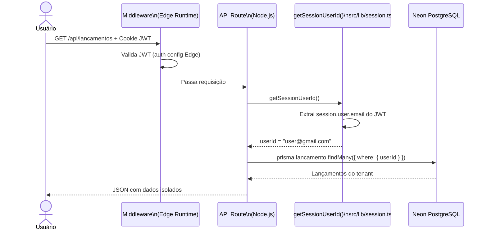

# Multi-tenancy

## Modelo de isolamento

| Camada | Modelo de isolamento | Identificador discriminador | Evidência |
|---|---|---|---|
| Banco de dados | Linha por tenant (discriminador `userId`) — banco e schema compartilhados | `userId` (e-mail Google) | `prisma/schema.prisma`, `src/lib/session.ts` |
| Cache | N/A — o sistema não possui camada de cache | — | // CARÊNCIA: não identificado no código |
| Filas | N/A — o sistema não possui filas assíncronas | — | // CARÊNCIA: não identificado no código |
| Armazenamento de arquivos | N/A — arquivos de importação são processados em memória e descartados | — | // CARÊNCIA: não identificado no código |

## Resolução do tenant na entrada da requisição

| Tipo de entrada | Fonte do identificador | Resolvedor | Evidência |
|---|---|---|---|
| Requisição HTTP para API Routes | Cookie JWT `next-auth.session-token` (campo `email`) | `getSessionUserId()` em `src/lib/session.ts` | `src/lib/session.ts:1` |
| Requisição HTTP para Middleware | Cookie JWT (campo `onboardingCompleto` na sessão) | `NextAuth(authConfig)` no middleware Edge | `middleware.ts:5` |
| Login inicial | Callback `jwt()` do NextAuth, campo `user.email` | `src/auth.ts:22` | `src/auth.ts:22` |

## Diagrama de resolução do tenant

## Roteamento de dados por tenant

| Operação | Mecanismo de roteamento | Risco se mal aplicado | Evidência |
|---|---|---|---|
| Leitura (findMany, findUnique) | `where: { userId }` obrigatório em todas as queries | Vazamento de dados de outros usuários | `src/app/api/lancamentos/route.ts:363` |
| Escrita (create) | `data: { ...body, userId }` injeta o tenant automaticamente | Dados criados sem tenant ficam acessíveis a qualquer usuário (não acontece pois schema exige `userId`) | `src/app/api/lancamentos/route.ts:398` |
| Atualização (updateMany) | `where: { id, userId }` garante que só lançamentos do tenant sejam alterados | Atualização de dados de outro tenant se `userId` for omitido | `src/app/api/lancamentos/route.ts:421` |
| Exclusão (deleteMany) | `where: { id, userId }` garante que só lançamentos do tenant sejam excluídos | Exclusão de dados de outro tenant | `src/app/api/lancamentos/route.ts:409` |
| Criação de sessão (onboarding) | `where: { userId }` no upsert de `UserProfile` | Perfil de usuário incorreto | `src/app/api/onboarding/route.ts:640` |

## Segregação de recursos compartilhados

O sistema não possui recursos compartilhados que necessitem de particionamento por tenant além do banco de dados. Arquivos de importação são lidos em memória pela API Route e descartados após o processamento — sem armazenamento persistente de arquivos.

## Gestão do ciclo de vida de tenants

| Etapa | Operação executada | Componente responsável | Evidência |
|---|---|---|---|
| Criação | `userProfile.create` com `userId = email` e `onboardingCompleto = false` (ou `true` para usuários com dados existentes) | Callback `jwt()` no primeiro login | `src/auth.ts:24` |
| Ativação | Conclusão do wizard de onboarding → `onboardingCompleto = true` | `PATCH /api/onboarding` + callback `jwt()` com trigger `"update"` | `src/app/api/onboarding/route.ts:634`, `src/auth.ts:35` |
| Suspensão | // CARÊNCIA: não identificado no código. Remover o e-mail de `ALLOWED_EMAILS` impede novo login, mas a sessão existente permanece válida. | — | — |
| Remoção | // CARÊNCIA: não há endpoint ou script de remoção de dados de um tenant | — | — |

## Garantias de não vazamento entre tenants

O isolamento é imposto pela sessão e pelo helper `escopoDoUsuario()` em `src/lib/tenant.ts`: as rotas aplicam o `userId` autenticado aos filtros antes de consultar ou alterar dados. O helper rejeita um `userId` divergente e `dadosDoUsuario()`/`dadosAtualizaveisDoUsuario()` impedem que o payload crie ou mova registros para outro tenant.

Há testes automatizados de isolamento para lançamentos e categorização (`src/app/api/lancamentos/route.test.ts`, `src/app/api/categorizar/route.test.ts`). Ainda não há:

- Middleware ou interceptor Prisma que aplique o filtro automaticamente
- Política "negar por padrão" a nível de banco (Row-Level Security no PostgreSQL)

// CARÊNCIA: a ausência de Row-Level Security no Neon PostgreSQL significa que uma query nova que não use o helper ainda poderia retornar dados de todos os tenants. A proteção continua no código da aplicação.
